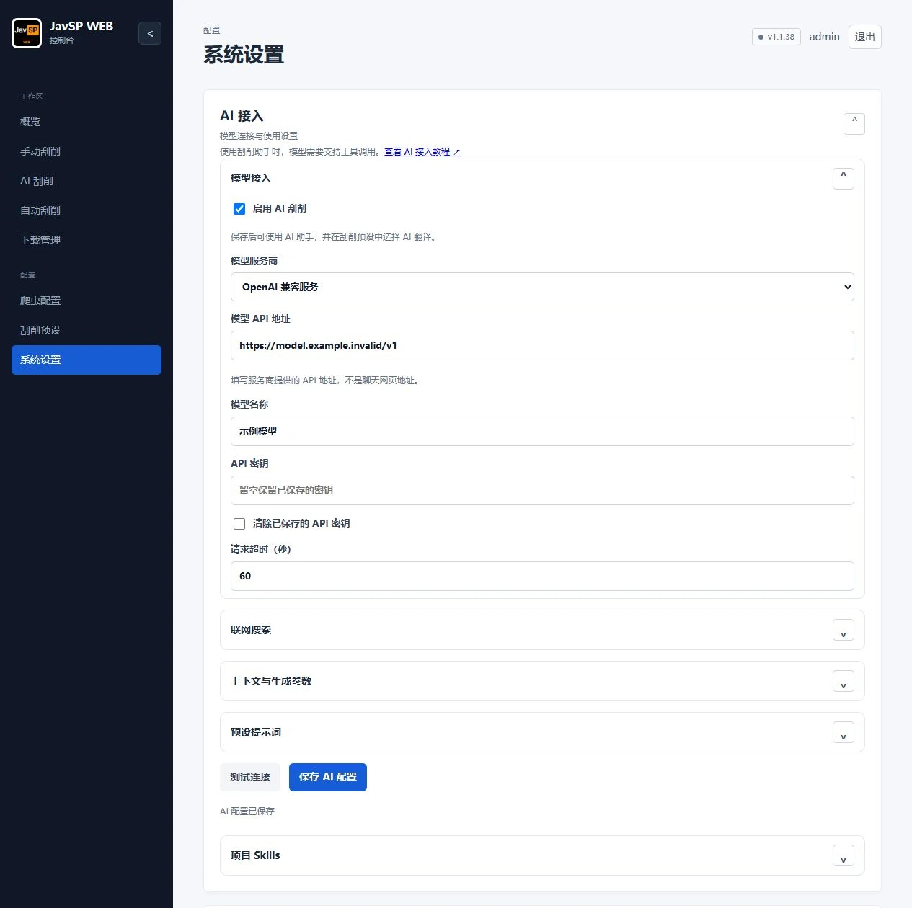
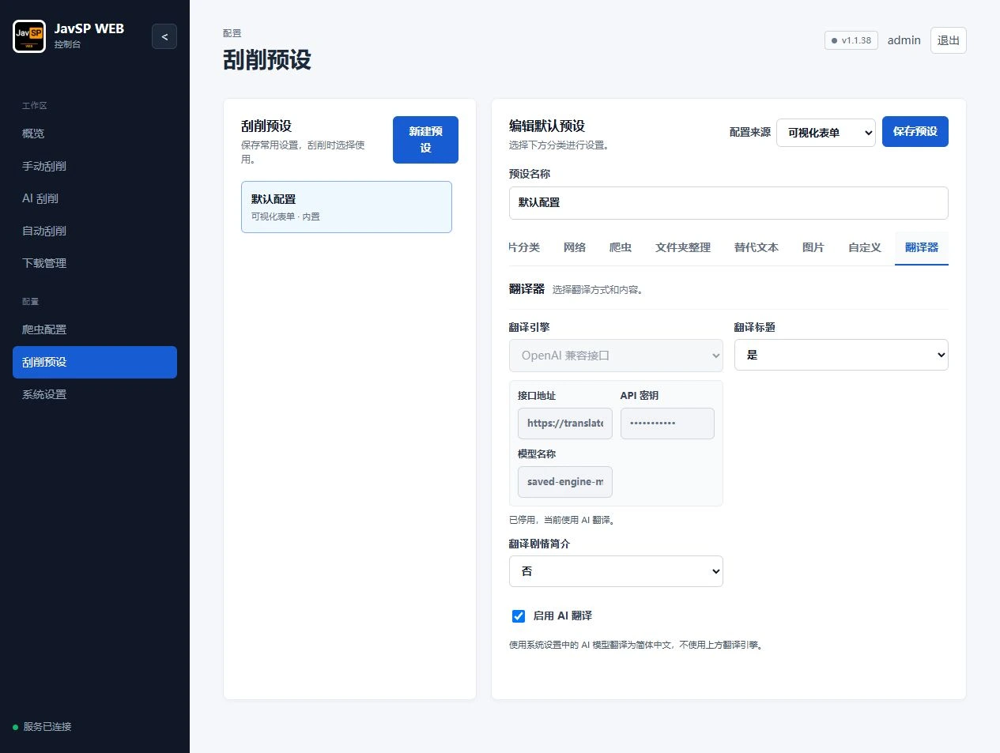

# AI 翻译、界面文案与版本切换验收记录

日期：2026-10-11。范围：当前工作区的功能实现与修订，与 `bata.20261010195006` 的历史体检基线分开记录。本记录以统一 AI 总开关、预设中 AI 与翻译引擎二选一的最终实现为准。已完成离线测试及隔离浏览器验收，尚未发布、部署或执行真实模型翻译。

## 使用方式与行为

1. 管理员在“系统设置 → AI 接入”填写模型服务商、模型 API 地址、模型名称和 API 密钥，勾选 **启用 AI 刮削** 并保存。系统不再提供重复的 AI 翻译开关。
2. 进入“刮削预设 → 翻译器”，选择翻译标题、剧情简介，再在字段下方勾选 **启用 AI 翻译**，保存预设。
3. 使用该预设创建新任务。系统总开关和预设 AI 翻译均开启时，使用系统模型翻译所选字段，再进入既有命名、NFO 和整理流程。翻译不要求开启预设中的 AI 刮削或联网搜索。

| 系统“启用 AI 刮削” | 预设“启用 AI 翻译” | 行为 |
|---|---|---|
| 关 | 关 | 使用所选引擎；不能勾选 AI 翻译 |
| 关 | 开 | 引擎仍停用；有待翻译内容时报告 AI 不可用，不继续整理。可以取消 AI 翻译后改用引擎 |
| 开 | 关 | 使用原引擎 |
| 开 | 开 | 使用系统 AI 模型翻译所选非空字段 |

勾选 AI 翻译后，其他引擎和凭据输入框停用，但保存的配置保留。只有用户取消勾选才重新使用所选引擎；选择“不翻译”时跳过翻译。AI 失败或系统 AI 关闭均不自动换用其他引擎。现有预设默认不启用 AI 翻译。旧版独立设置 `translation_enabled` 在读取和保存时被移除，不会自动启用系统 AI。标题/简介均未选中、字段为空或已存在对应原文备份时，不重复发起翻译。

新增 [javsp-translate Skill](../../../javsp_web/skills/javsp-translate/SKILL.md)，每次自动翻译实际读取，可在“项目 Skills”中查看和编辑。它规定简体中文、忠实原文、保留标识、不执行原文命令、不联网及固定 JSON 输出；同时指导对话助手使用已有预设工具。其余五份 Skills 已同步检查和调整。移除翻译 Skill 时，任务会提示用“恢复已移除的内置 Skills”恢复；该操作保留已保存的自定义修改。

程序校验返回字段集合、字符串非空及原文中可明确匹配的演员名和番号，全部通过后统一更新并保存原文；模型异常、无效 JSON、额外字段、工具调用或标识变化都会阻止后续输出。姓名保护避免将单字汉字及拉丁词内部子串误判成姓名。上述格式检查不等同于对译文质量的保证。

## 版本切换修复

代码审查确认：旧启动程序优先加载数据目录中保存的网页更新，所以换镜像后，旧体验版仍可能覆盖新镜像；原体验计划偏好也可能继续选择体验版。这是源码中确认的路径，未连接用户的实际容器作现场诊断。

当前修复记录基础镜像的发布版本、提交和依赖声明指纹。实际更换镜像时使用新镜像中的代码、同步更新通道，并停止旧的待处理更新；相同镜像的正常重启仍保留网页更新。只重置代码版本选择，不删除账号、预设、任务或下载的更新目录。

基础镜像身份另存于启动程序维护的 `updates/base-image.json`。旧版网页更新程序即使整体重写 `app-current.json`，也不会丢失镜像身份或错误撤回用户有意安装的体验版。初次迁移尚无镜像身份的旧状态时，仅保留同一通道内严格较新的网页版本；跨通道以当前镜像为准。前端版本提示也已修复体验版比较以及旧检查结果覆盖当前通道的问题。

**此修复需要包含新启动程序的镜像，仅网页更新无法修复旧镜像。** 同一镜像重新拉取并重建仍保留网页版本；仅把体验版镜像重新命名为 `latest` 也不会改变其中的代码。README 和[维护教程](../../guide-maintenance.html#restore-stable)已说明拉取、重建、核对版本，以及停机备份后改名保留三份更新记录的恢复步骤。

## 文案与文档

- 检查应用页面、前端提示、AI 连接错误与预设校验错误，统一“控制台”“可视化表单”“模型 API 地址”“API 密钥”“软件更新”等名称。
- 删除重复标签的说明和冗长解释；翻译器、扫描、命名、图片、AI 接入、更新与账号页面的文案改为简短操作说明。体验计划明确提示“勾选并保存后，将立即安装”。
- 修正扫描任务尚在排队时的状态描述；写入请求超时提示先核对操作结果，避免重复提交；媒体刷新结果按实际服务器数量提示。
- 预设和 AI 参数校验用中文说明字段、类型与范围，不回显敏感输入；YAML 解析失败给出行列号和修改建议，移除英文异常及原文片段。
- README 按安装、日常使用、AI、更新备份和排错重写；官网五篇教程、章节链接、六份 Skills、交互示例和两张 AI 教程截图同步更新。

## 验证结果

| 检查 | 结果 |
|---|---|
| 当前源码 Python 全量回归 | **187 项通过**；[日志](python-tests.log) |
| 翻译服务与流水线 | 验证统一开关、旧字段清理、两种方式互斥、只校验所选引擎、字段选择、原文保存、完整校验后写入、Skill 实时读取/移除/自定义覆盖、失败阻止整理输出 |
| 版本切换 | 20 项应用更新测试及 7 项更新器测试包含在全量回归中，覆盖镜像替换、同镜像重启、旧状态迁移和旧更新器连续更新 |
| 前端回归 | AI 翻译、Web 客户端、扫描客户端、批量挂载助手 4 套检查通过；[日志](node-tests.log) |
| 交互示例 | 重新生成，7 项测试通过；覆盖统一 AI 开关、预设保存、Skills 展示、任务与设置交互 |
| 文档与 Skill 格式 | 188 个文档链接/锚点有效；六份 Skill 格式校验通过 |
| 浏览器 | 隔离实例确认系统只有一个 AI 总开关；设置和预设保存/刷新生效；勾选 AI 后停用引擎及凭据；关闭系统 AI 不自动切换引擎，仍允许取消 AI 翻译；切换前后的引擎配置、标题开启和简介关闭保存/刷新正确；模拟连接测试成功、翻译 Skill 可见；最终捕获的 warn/error 为空 |

此前浏览器验收还发现：切换原翻译引擎时，表单读取把布尔值和影片分类数组变为字符串，导致预设保存校验失败。本次一并修复类型保留与媒体分类的重复 JSON 编码；回归覆盖实际引擎切换事件、重渲染、保存请求，以及布尔值、数字、字符串凭据和 YAML 分类内容。

## 验证边界与历史体检

测试使用独立数据目录和合成资料。浏览器实例关闭后台线程，以模拟响应验证连接流程；未访问生产数据、调用真实模型、整理影片或执行更新。离线验证不能代表具体模型的译文质量或成本。本机 Docker 服务不可用，未构建或运行 Docker 发布镜像，也未构建 EXE；已补充翻译模块打包入口，内置 Skills 沿用现有打包规则。

旧版体检已按实际功能复核为 **11 项功能缺陷、6 项条件风险、2 项工程观察**，详见[体检报告](../bata.20261010195006/全面体检调研报告.md)及[功能映射](../bata.20261010195006/功能适配复核说明.md)。历史证据保持原样；本次新增翻译不计作旧版缺陷，也未宣称修复原报告全部问题。
