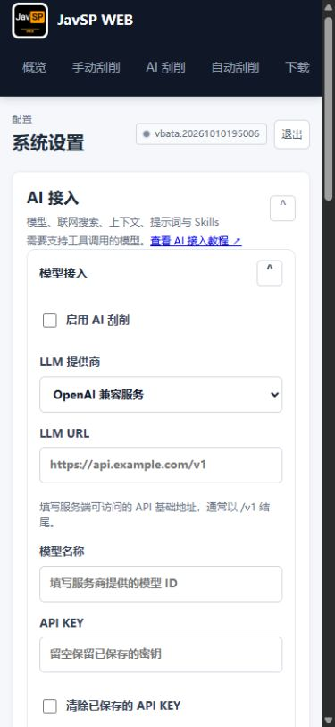
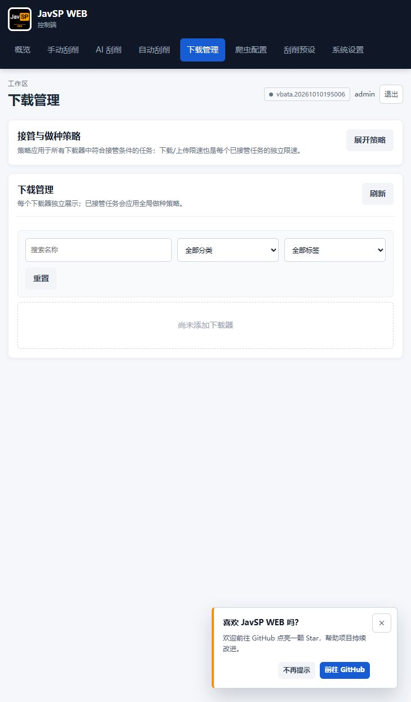

# 证据与复现说明

目标提交：`1e2d73bc180bf1b61ec83ed10df2fd6687acf275`。报告日期：2026-10-11（北京时间）。

同日完成[功能适配复核](../功能适配复核说明.md)：原 19 条发现重新区分为 11 项功能缺陷、6 项条件风险、2 项工程观察；原始日志和复现结果均保留。该复核没有重跑测试或证明代码已修复；分类与优先级以修订后的主报告和 `audit-metadata.json` 为准。

## 证据索引

| 文件 | 内容 |
|---|---|
| `github-jobs.json` | GitHub Actions 公开 job/step 状态、时间和 commit |
| `python-tests.log` | 142 项 Python 回归，全部通过 |
| `node-tests.log` | 3 套 Node 检查，全部通过 |
| `resolved-requirements.txt` | 本次体检 venv 的解析依赖，非历史镜像 SBOM |
| `performance.json` / `.log` | 合成记录性能测试原始输出 |
| `security_repro.py` / `security-repro-results.json` | operator 配置读取、会话、损坏认证文件 |
| `security_dns_repro.py` / `security-dns-repro-results.json` | 模拟 DNS 重绑定、本地 HTTP 实际传输 |
| `security_redaction_repro.py` / `security-redaction-repro-results.json` | 合成 Bearer/Cookie 脱敏 |
| `repro_tasks_storage.py` / `repro_tasks_storage_results.json` | 8 个任务/文件/锁/下载故障场景 |
| `probe_frontend_release.py` / `frontend-release-probes.log` | 更新/监护生产函数的 mock 故障探针 |
| `probe_frontend.cjs` / `frontend-probes.log` | 版本提示及下载筛选监听的 VM 探针 |
| `browser-smoke.json` | 自动刮削/爬虫/预设页面状态及控制台日志快照 |
| `browser-mobile-settings.png` | 390×844 系统设置抽查 |
| `browser-downloads.png` | 未配置下载器的空状态抽查 |
| `audit-metadata.json` | 提交、源码树/压缩包校验值、测试与路由清单 |
| `sha256-manifest.json` | 报告及证据文件的 SHA-256 校验清单（不包含清单自身） |

所有秘密均为合成测试字符串。任务结果中的绝对临时路径仅用于解释隔离测试；它们不是生产影片路径。原审查完整源码副本和 venv 保留在项目 `tmp/audit-bata-20261010195006/`。

`frontend-release-probes.log` 第一行的中文异常文字存在原 PowerShell 输出编码乱码；源异常文字为“已有更新正在执行”。保留原日志，英文状态、断言和生产源码可交叉核验，不以乱码内容作额外推断。

## 重跑方式

复现脚本按“脚本同目录下存在 source/”设计。原 tmp 审查目录可以直接运行；本目录保存的是证据副本，不重复包含完整源码和虚拟环境。如在其他位置重跑，可在项目根目录按以下 PowerShell 步骤新建独立目录，切勿指向原项目 data：

```powershell
$auditRoot = Join-Path $PWD 'tmp/audit-replay-bata-20261010195006'
New-Item -ItemType Directory -Force -Path $auditRoot | Out-Null
git archive --format=zip --output="$auditRoot/source.zip" 1e2d73bc180bf1b61ec83ed10df2fd6687acf275
Expand-Archive -LiteralPath "$auditRoot/source.zip" -DestinationPath "$auditRoot/source"
Copy-Item 'docs/reports/bata.20261010195006/evidence/*.py' -Destination $auditRoot
Copy-Item 'docs/reports/bata.20261010195006/evidence/*.cjs' -Destination $auditRoot
# 使用 Python 3.12；此命令中的 python 应解析到该版本。
python -m venv "$auditRoot/venv"
& "$auditRoot/venv/Scripts/python.exe" -m pip install -r "$auditRoot/source/requirements.txt" -r "$auditRoot/source/tests/requirements.txt"
& "$auditRoot/venv/Scripts/python.exe" "$auditRoot/security_repro.py"
& "$auditRoot/venv/Scripts/python.exe" "$auditRoot/security_redaction_repro.py"
& "$auditRoot/venv/Scripts/python.exe" "$auditRoot/repro_tasks_storage.py" | Set-Content -Encoding utf8 "$auditRoot/repro_tasks_storage_results.json"
& "$auditRoot/venv/Scripts/python.exe" "$auditRoot/probe_frontend_release.py"
node "$auditRoot/probe_frontend.cjs"
```

`security_dns_repro.py` 临时绑定 **127.0.0.1:80**，由脚本自行关闭；仅在该端口空闲且允许本地监听时运行。它模拟 DNS 返回值，不查询外部 DNS；不要为运行探针停止已有的真实服务。

运行现有回归时从隔离源码执行，并显式设置测试数据目录：

```powershell
Set-Location "$auditRoot/source"
$env:JAVSP_WEB_DATA_DIR = "$auditRoot/regression-data"
$env:JAVSP_VENDOR_DIR = "$auditRoot/source/vendor/JavSP"
$env:PYTHONPATH = "$auditRoot/source"
& "$auditRoot/venv/Scripts/python.exe" -m unittest discover -s tests -v
node tests/test_web_client.cjs
node tests/test_scan_client.cjs
node tests/test_mount_batch_client.cjs
& "$auditRoot/venv/Scripts/python.exe" scripts/audit_web_performance.py --sizes 100 1000 5000 10000 --output "$auditRoot/performance.json"
```

复现依赖 mock/故障注入的项目不能解释为端到端线上实测。测试脚本中的 stdout、JSON 和断言用于佐证指定条件下的控制流；浏览器抽查只覆盖空数据与未接入外部服务时的基本呈现。真实 Docker、NAS、模型、下载器和媒体服务器需另行完成集成验收。

## 浏览器抽查截图




