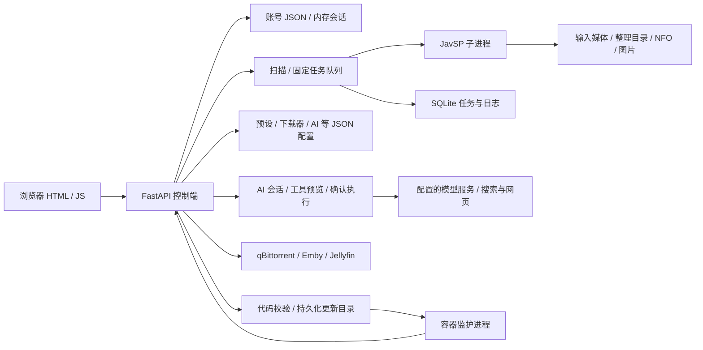

# JavSP WEB 全面体检调研报告

**受检版本：bata.20261010195006**
**报告日期：2026-10-11（北京时间）**
**源码基线：1e2d73bc180bf1b61ec83ed10df2fd6687acf275**

**功能适配复核：2026-10-11。** 本次修订按目标版本的 README、页面说明、角色入口及实际控制流重新分类；保留原复现证据，不将部署加固建议或未承诺能力混算为功能缺陷。详见[功能适配复核说明](功能适配复核说明.md)。

## 1. 结论与适用范围

该版本已具备较完整的单机媒体管理控制台：后台扫描、分 P 合并、任务分页、下载器联动、媒体库同步、AI 辅助和容器内代码更新均有实现，也有有效的回归测试基础。**按单机、单控制进程、可信管理员管理媒体的产品范围评估，常规回归通过，下载完成判定、任务取消、还原及更新并发仍有可复现的功能缺陷。** 多租户隔离、任意不可信 Python 沙箱和多进程横向扩展不属于目标版本的已承诺能力。

原报告的 19 条编号和证据全部保留，复核后区分为 **11 项功能缺陷（P1 4、P2 5、P3 2）、6 项条件性风险（P1 2、P2 4）、2 项构建边界/元数据观察（不计功能缺陷优先级）**。其中 SEC-03 只将“删除后同名新建使旧会话取得新账号权限”计为功能缺陷；改密保留会话另作安全策略说明。原“19 项问题”的合并口径不再使用。没有证据表明生产数据已受损，也无足够证据认定 P0。

优先修复与现有流程直接冲突的四项 P1：未完成下载提前触发整理、取消状态被覆盖、更新期间缺少任务互斥、新镜像被旧持久化代码覆盖。认证数据损坏恢复默认口令、分 P 移动中途失败缺少恢复清单仍有较高影响，但应按故障条件风险单独安排恢复验收。

| 使用场景 | 体检判断 | 主要理由 |
|---|---|---|
| 单管理员、受控内网、人工观察的体验使用 | 有条件可用 | 常规页面和已有回归正常；应保护数据并控制自动化范围 |
| 管理员与可信操作员共同使用 | 按已有角色能力使用 | 操作员本来可查看预设；同名账号重建后的会话身份混淆需修复 |
| 持续自动刮削、自动移除种子、大批量无人值守整理 | 建议优先修复四项功能 P1，并演练故障恢复 | 完成判定、取消、更新并发有可重复缺陷；分 P 恢复依赖 I/O 故障条件 |
| 依靠网页自更新持续维护 | 需要补强后再依赖 | 维护互斥、镜像/持久化代码优先级、崩溃恢复不完整 |
| 公网直接开放、不同租户共享媒体或提交不可信代码 | 超出本报告的产品验收范围 | 目标文档未承诺租户数据隔离或不可信爬虫沙箱；不能因此判定当前功能失败 |

优先级含义：P1＝优先处理的重要安全/数据/工作流影响；P2＝影响较局部或前提更具体；P3＝低风险体验问题。优先级只在对应分类内表示工程处置建议，不是 CVSS 分数；条件风险的 P1 不等于正常流程必然失败。

## 2. 版本定位与检查方法

### 2.1 版本定位

目标不是本地名为 `bata` 的旧 Git tag，也不是当前 HEAD。

- [目标提交](https://github.com/APecme/JavSP-Web/commit/1e2d73bc180bf1b61ec83ed10df2fd6687acf275)：`Add advanced AI settings, search controls and website guide`。
- [GitHub 构建 38049788026](https://github.com/APecme/JavSP-Web/actions/runs/38049788026)：结论 `success`。
- 标签步骤在 UTC `2026-10-10 11:50:06` 执行；流水线用 `Asia/Shanghai` 格式化为 `bata.20261010195006`，时间、公式与提交对应闭合。
- 此版本号是镜像中的 release label。该流水线只发布可变的 Docker `:bata` 标签，不能将版本号直接当成已存在的同名 Docker tag。
- 原体检开始时工作区 HEAD 为 `f02d890`，比目标提交多 3 个后续文档提交。当时对 `javsp_web/`、`vendor/`、`requirements.txt`、`Dockerfile`、`launcher.py` 的比较未见差异；使用目标提交的独立导出副本完成审查。后续按用户要求新增的 AI 翻译不属于本报告受检基线。
- 相比 `v1.1.39`，目标提交累计变更 31 个文件，新增 3,165 行、删除 28 行，主要增量包括 AI 接入、工具与会话、高级搜索配置及相关测试/文档。

本次没有取得并运行发布当时的不可变镜像 digest，也没有核验现网实例的容器身份。因此结论是**准确提交级别的体检，加公开发布记录核验**，不是已发布二进制镜像的完整取证。

### 2.2 实际执行

| 检查 | 结果与证据 |
|---|---|
| Python 回归 | `unittest discover -s tests -v`：**142 项通过，7.812 秒**；见 [日志](evidence/python-tests.log) |
| 前端脚本回归 | `test_web_client.cjs`、`test_scan_client.cjs`、`test_mount_batch_client.cjs` 全部通过；见 [日志](evidence/node-tests.log) |
| JS 语法 | 3 个生产 JS 文件通过 `node --check` |
| 依赖一致性 | 独立 venv 的 `pip check` 无冲突；保存 [实际解析版本](evidence/resolved-requirements.txt) |
| 定向安全验证 | 真实登录 TestClient 验证角色、会话、损坏认证文件；合成秘密验证脱敏；模拟 DNS + 真实本地 HTTP 验证 SSRF |
| 任务与数据验证 | 8 个受控场景复现，归并为 7 个根因；使用临时 SQLite、JSON 和假视频，外部下载器/进程 mock |
| 更新验证 | 生产更新/监护函数的隔离故障探针；未实际更新应用或杀生产进程 |
| 浏览器冒烟 | 登录、概览、手动刮削、AI 未配置提示、自动刮削、下载管理、爬虫配置、预设及系统设置均可打开；捕获的 warn/error 为空 |
| 小屏抽查 | 390×844 下系统设置、手动刮削未出现全页横向溢出；另检查默认 1280×720 初始页面 |
| 性能 | 100 / 1,000 / 5,000 / 10,000 条合成任务；每项通常重复 3 次，报告中位数；见 [原始数据](evidence/performance.json) |
| 发布记录 | 目标 beta 的 Node、Python、监护启动、CA/HTTPS 步骤均显示成功；见 [公开 job 数据](evidence/github-jobs.json) |

环境为 Windows、Python **3.12.14**、Node **24.13.0**；发布工作流使用 Linux/Python 3.12 和 Node 22。安装的是体检时由版本范围解析出的依赖，并非已证明与发布镜像完全相同。`vendor/JavSP/poetry.lock` 未被顶层安装流程使用，不能补足这一差异。

原体检检查均使用独立数据目录，未修改业务代码。体检及后续 AI 翻译开发均未读取原项目 `data` 中的账号、密钥或任务，未进行真实影片整理、种子删除、软件更新或付费 LLM 调用。原工作区已有的 `.gitignore` 修改、`build-windows.ps1` 删除和 `tmp/` 内容不作为目标版本缺陷。

### 2.3 尚未覆盖的范围

本地 Docker daemon 未运行，因此没有重建/运行目标 Linux 容器；未做真实 NAS/CloudDrive2 长时间断连、生产 qBittorrent/Emby/Jellyfin 联调、真实爬虫可用率、LLM 准确率/成本、Windows EXE 托盘打包验收、ARM64 验收、长稳压测、完整读屏/键盘无障碍或漏洞库扫描。报告不提供虚构的覆盖率、爬虫成功率或具体 CVE 结论。

发布的 HTTPS 检查脚本即使某站点 TLS 失败也可能仅打印结果，唯一硬断言是存在 CA 证书。因此该步骤为绿色**不等于所有站点都可用**；容器启动门禁的一次 `/health` 成功也不等于通过完整生命周期测试。

## 3. 架构与能力评估

该架构适合单进程、单机可信管理场景。任务数据库已从整体 JSON 读写演进为 SQLite，固定任务池默认 4 个 worker，支持批次并发；手工扫描先返回 HTTP 202，再后台访问挂载盘。这些改进对可用性有实际价值。

主要薄弱点在于：账号和安全配置仍采用宽松 JSON 容错；任务工作线程持旧 dict 全量写回；文件系统操作没有完整事务清单；更新维护状态未成为所有入口共同遵守的约束。功能数量增长较快，而状态机和失败恢复没有同等程度收敛。

| 维度 | 评价 | 已有有效设计 | 主要缺口 |
|---|---|---|---|
| 扫描/刮削 | 基本功能完整，边界可靠性待修 | 后台扫描、分 P、固定线程池、批次限制 | 取消状态、部分整理、慢挂载锁传播 |
| 任务存储 | 基础较扎实，写入协调不足 | WAL、任务/日志分表、索引、事务迁移、SQL 参数绑定 | 旧快照覆盖编辑/删除，去重索引被截断 |
| 安全与权限 | 账号复用需修复，策略需按部署界定 | PBKDF2、随机 salt/token、HttpOnly、SameSite=Lax；管理员写权限 | 同名账号会话混淆；认证文件故障策略、共享预设凭据与会话撤销策略 |
| AI | 具备较清晰的工具确认边界 | 管理员限制、会话 owner、写工具确认、来源验证、次数/长度限制 | 自由文本脱敏、DNS 对端验证、真实模型质量未测 |
| 前端 | 常规流程可用 | 分页、ETag、共享 GET、超时/退避、后台轮询控制 | 重复函数定义、缺浏览器自动回归、两处小交互问题 |
| 发布/更新 | beta 门禁较好，恢复逻辑不足 | Git blob 校验、路径约束、拒绝依赖变化、无需 Docker socket | 任务互斥、崩溃状态、新镜像优先级、正式版门禁不对等 |
| 可运维性 | 适合小规模人工管理 | 诊断日志、更新状态、数据目录持久化 | 备份恢复演练、保留策略、统一健康度和多进程边界 |

AI 保存爬虫需要确认，但执行已有自定义 Python 爬虫属于管理员提供的代码扩展，未建立操作系统沙箱。不能把它直接报告为未授权 RCE；也不能把 AI 工具中的“只读测试”理解为代码绝无副作用。AI Markdown 使用 `textContent` 和 HTTP(S) 链接限制，本次未发现该渲染器的直接 HTML 注入路径。

## 4. 发现分类总表

下列源码位置均指目标提交。功能缺陷表示正常支持流程中的可复现行为与现有功能冲突；条件性风险要求额外的故障、恶意来源或信任边界前提；工程观察不等于本次官方 beta 使用失败。完整功能依据见[逐条映射](功能适配复核说明.md)。

| 编号 | 分类 / 优先级 | 发现及用户影响 | 主要证据位置 |
|---|---|---|---|
| SEC-01 | 条件风险 / P2 | operator 可查看预设，其中含翻译 API key、代理密码；只有将账号划为不同凭据信任级别时形成隔离风险 | `server.py:548,724,907` |
| SEC-02 | 条件风险 / P1 | 既有 `users.json` 损坏后自动重建 `admin/admin` 并覆盖账号 | `storage.py:41,72,152` |
| SEC-03 | 功能缺陷 / P2 | 删除后同名重建管理员，旧 cookie 可继承新账号权限；改密保留会话单列为策略观察 | `auth.py:12,29`；`server.py:528` |
| SEC-04 | 条件风险 / P2 | 恶意来源 DNS 校验与实际连接重新解析，有条件到达内网 | `ai_scrape.py:40,53` |
| SEC-05 | 功能缺陷 / P2 | 已声明的工具结果脱敏遗漏文本 Bearer 正文、Cookie；须先有含凭据文本进入工具 | `ai.py:131`；`ai_router.py:322` |
| T01 | 功能缺陷 / P1 | 下载 99.96% 被四舍五入为 100%，提前命中自动刮削/种子移除 | `qbittorrent.py:97`；`server.py:1501,1609` |
| T02 | 功能缺陷 / P1 | 启动准备阶段取消后，旧任务副本把 cancelled 写回 running | `tasks.py:1167,1231,1962` |
| T03 | 条件风险 / P1 | 分 P 第二次移动发生 I/O 故障后，第一段已移动且没有完整还原清单 | `vendor/JavSP/javsp/datatype.py:196` |
| T04 | 功能缺陷 / P2 | 默认相对输出路径导致“可还原”按钮存在但实际还原失败 | `vendor/JavSP/config.yml:118`；`tasks.py:832` |
| T05 | 功能缺陷 / P2 | 图片重试期间删除记录会复活，已接受的资料编辑也会被覆盖 | `tasks.py:809,1890,2027`；`task_store.py:24` |
| T06 | 功能缺陷 / P2 | 下载历史仅留 1,000 条，同时丢弃去重键，旧下载会重复刮削 | `storage.py:372`；`server.py:1571` |
| T07 | 条件风险 / P2 | 挂载图片 stat 长时间阻塞时，持全局任务锁拖住无关提交/取消/写状态 | `tasks.py:587,719,392` |
| FR-01 | 功能缺陷 / P1 | 更新期间可进入新任务，安装后未重新检查就立即退出 Web 进程 | `updater.py:85,183`；`app_update.py:131` |
| FR-02 | 功能缺陷 / P1 | 拉取新镜像并复用 data 后，旧持久化应用仍可能优先运行 | `app_supervisor.py:85` |
| FR-03 | 条件风险 / P2 | 更新下载阶段容器异常中断后 ACTIVE 状态不能恢复，再次更新被拒绝 | `updater.py:81,177`；`app_supervisor.py:116` |
| FR-04 | 构建边界观察 | 无 release build args 的自建镜像，健康版本比较失败后被终止；不适用于本次官方 beta | `Dockerfile:3`；`app_supervisor.py:100` |
| FR-05 | 元数据观察 | VERSION=1.1.39，包版本=1.1.38；官方 beta 的 release label 仍正确 | `VERSION:1`；`__init__.py:3` |
| FR-06 | 功能缺陷 / P3 | 服务端已确认 beta 最新，顶栏仍显示无法比较版本 | `web/assets/app.js:973` |
| FR-07 | 功能缺陷 / P3 | 下载筛选重置重复绑定 once 回调，可能一次执行多次、下次不响应 | `web/assets/app.js:2161` |

### 4.1 优先问题的实际含义

**权限和认证。** SEC-01 的接口响应与合成凭据证据有效，但目标前端本来保留操作员的预设页，后端也允许已登录用户读取；隐藏的是系统设置等管理员页面，不能据此推导预设读取越权。只有要求“操作员能用预设但不能知道其中凭据”时才需要新的脱敏投影。SEC-02 是文件损坏后的认证失守，未证明普通远程请求能制造损坏。SEC-03 的同名账号复用突破了已存在的管理员角色检查，保留为功能缺陷；单纯改密后维持 12 小时内既有会话则是未明确约定的会话策略，建议提供撤销能力，不能宣称改密功能本身失败。

**媒体数据安全。** T01 的删除请求为 `deleteFiles=false`，不是直接删除媒体；提前移除未完成种子、将仍在下载的文件交给整理流程违背“下载完成后自动刮削”，应先修复。T03 注入第二段移动失败，证据是文件分散和清单缺失，没有证据证明媒体字节已经丢失；项目未承诺任意 I/O 失败下的文件事务，故列为高影响恢复风险，按实际挂载条件演练。

**停止意图。** T02 的复现中没有启动任何子进程，但状态最终为 running；重启恢复逻辑还可能重新排队。取消操作应当改变可持久恢复的任务状态，不能只维护内存标记。

**更新可信度。** FR-01 证明新工作未受维护门禁保护，更新线程仍走 `_exit(75)`；没有实际终止用户任务。FR-02 证明新镜像环境下，子进程仍选择旧 overlay 的目录和版本。镜像已更新、服务可访问和代码已切换必须分别验证。

### 4.2 条件性发现的边界

SEC-04 使用模拟 DNS 变化和真实本机 HTTP 服务验证，前提是攻击者可控制被选中的资料域名及解析；AI URL 端口限制为 80/443，并非任意端口访问。SEC-05 只有当源码/日志/输入先包含其他凭据时才构成外传路径，本次没有发现真实凭据泄露；保留为功能缺陷的依据是 README 明确说明“工具结果会隐藏凭据”。FR-04 针对不带版本参数的自建镜像，README 的 Docker 流程使用预构建官方镜像，不能将该构建边界算作目标 beta 启动失败。

## 5. 性能与容量观察

下表为合成已完成任务、每任务 40 条进度事件、本地磁盘、进程内 TestClient 的中位数。认证依赖被替换、后台线程禁用，不含网络往返、真实刮削、NAS 延迟或浏览器绘制。

| 历史任务数 | 50 条手工分页 | 24 条概览 | 未变化分页/ETag | 单条详情 | 单条保存 | 不分页响应体 |
|---:|---:|---:|---:|---:|---:|---:|
| 100 | 6.68 ms | 6.95 ms | 6.69 ms | 2.01 ms | 4.74 ms | 0.115 MB |
| 1,000 | 13.18 ms | 18.91 ms | 11.99 ms | 1.68 ms | 3.99 ms | 1.154 MB |
| 5,000 | 51.36 ms | 122.82 ms | 38.30 ms | 2.58 ms | 5.40 ms | 5.774 MB |
| 10,000 | 83.40 ms | 241.95 ms | 69.16 ms | 2.97 ms | 6.19 ms | 11.549 MB |

分页响应约稳定在 **58 KB**，单条详情/保存保持毫秒级，是现有 SQLite 和预存摘要设计的收益。但总量增大后分页仍变慢；概览的分组窗口查询开销尤其明显。ETag 在当前实现中主要节省传输，仍需计算分页结果及序列化，不能视作消除了后端查询工作。

一万条时，不分页 API 本地耗时约 332 ms，gzip 约 413 ms；压缩前 11.55 MB、估算压缩后约 197 KB。这种高度重复的合成数据压缩率不能直接外推到真实任务。应继续让交互路径默认分页，避免旧接口/集成在频繁轮询时拉取全部记录。

累积日志重新解析微基准在 100 / 500 / 1,000 个事件下分别约 33 / 819 / 3,232 ms，反映反复扫描累计数组的增长特征。真实主任务已有 0.5 秒持久化节流，不能把该微基准等同于每个任务必然阻塞 3.2 秒；它提示后续可将进度聚合改为增量处理。

容量建议按证据而非虚构阈值制定：保留分页和摘要机制；优化概览分组/统计及变更版本号；将挂载 stat 移出全局任务锁；把去重索引与有界历史分离；为图片操作和媒体刷新合并排队。当前没有足够数据承诺并发用户数或每小时可处理影片数。

## 6. 部署、供应链和维护质量

1. **部署暴露面。** 桌面默认监听回环地址，Docker 示例发布 `8090:8090` 到宿主所有接口且首登为 `admin/admin`。文档要求改密，但没有强制引导；登录未见失败退避，cookie 未设 Secure。不能据此断言当前用户实例已开放公网。建议默认回环发布，远程访问采用受控入口及 HTTPS，明确可信代理配置。
2. **运行权限。** Dockerfile 未配置非 root 用户；自定义爬虫会以服务权限执行。应收窄挂载范围与服务账号权限，在镜像构建期完成证书安装，避免运行时为了证书更新长期依赖 root。
3. **产物可追溯性。** 顶层依赖为范围约束，基础镜像和第三方 Actions 未固定不可变引用，缺少发布依赖锁、SBOM 和历史 beta 不可变标签。无法仅凭提交恢复当时镜像。建议同一 digest 测试后发布，同时保存 commit、label、digest、resolved dependencies 和 SBOM。
4. **正式版发布门禁。** 本次 beta 有测试，但 `formal-release.yml` 直接构建发布 Docker/EXE，未复用同等门禁。应统一验证工作流。beta 没有发布并发协调，旧构建晚完成覆盖可变标签属于待验证的发布时序风险，未观察到此次发生。
5. **备份与恢复。** SQLite 任务迁移已有备份与失败关闭，但认证/设置 JSON 缺乏同等故障策略。运行中直接拷贝单个 `tasks.db` 不能作为完整备份方案，应使用 SQLite backup 或停机一致备份，并包括配置、会话资料、自定义爬虫和更新状态。备份含密钥，必须限制访问。
6. **保留策略。** 每任务诊断日志最多两份 2 MiB 是正向控制，但任务总量、AI 会话和历史更新包仍需保留/清理策略；不能把单任务限制理解为总磁盘有界。
7. **单进程边界。** 账号会话、任务队列、调度和锁均大量依赖进程内状态；模块导入即启动后台工作。应明确默认只运行一个控制进程，不能直接增加 Uvicorn workers 并共享 data 后声称横向扩展安全。
8. **维护债务。** `server.py` 约 2,048 行、`tasks.py` 约 2,053 行，前端 `app.js` 3,407 行且存在多处同名函数重复定义，后者覆盖前者。应拆分路由、状态机、文件整理、前端数据访问与视图，并引入禁止重复声明的 lint。
9. **文档与许可证。** 目标版本官网标识为 v1.1.34、demo 为 v1.1.31，与功能/包版本不统一；当前 HEAD 后续已改文档，不能把目标版文档问题不加区分地套到 HEAD。仓库声明包含 GPL-3.0 与 Anti-996 的 JavSP 核心，发布时宜随产物附许可证、对应源码和依赖清单；本次未做逐依赖许可证法律审查。

## 7. 整改路线与验收标准

建议按功能修复、故障恢复、部署选择分开验收。这里给出验收条件，不把未承诺的新能力或未经排期的工作量写成发布阻断承诺。

| 里程碑 | 工作范围 | 必须通过的验收 |
|---|---|---|
| A：已有功能修复 | 11 项功能缺陷；优先 T01/02、FR-01/02 | 99.96% 不派发/不移除；预启动取消与重启后均不执行；更新入口互斥；新镜像复用 data 运行目标代码；同名重建不复用旧身份；默认相对输出可还原；图片重试不覆盖删除/编辑；超过 1,000 下载不重复派发；工具凭据文本脱敏；版本提示和重置交互正确 |
| B：故障与威胁条件验收 | SEC-02/04、T03/07、FR-03 | 损坏认证文件保留并拒绝默认口令恢复；分 P 第二步失败有可恢复计划；单挂载阻塞不拖住无关提交；更新异常中断后可重试；DNS/代理/重定向验证实际对端 |
| C：产品策略与工程改进 | SEC-01、SEC-03 改密策略、FR-04/05、CI/运维 | 明确操作员能否读取预设密钥及是否提供会话撤销；自建镜像若列入支持范围则补默认参数验收；统一元数据；按部署需求完善发布门禁、产物追溯、浏览器回归与备份恢复 |

A 阶段完成前，可在空闲窗口执行更新并核验实际版本，谨慎启用下载完成自动整理/移除，先用媒体副本验证还原流程。多个账号共享预设时，应按当前“可查看预设”的实际能力分配可信操作员。是否另加租户隔离、非可信代码沙箱或多进程支持，属于产品范围决策。

## 8. 交付物与复核入口

- [安全、权限与 AI 专项](security-ai-findings.md)：SEC-01～SEC-05 的完整证据、前置条件和回归建议。
- [任务、存储与下载集成专项](tasks-storage-findings.md)：T01～T07，含 8 个故障场景及有效设计。
- [前端、更新与发布专项](frontend-release-findings.md)：FR-01～FR-07 及发布治理观察。
- [证据与复现说明](evidence/README.md)：环境、日志、JSON、脚本、浏览器抽查图及重跑步骤。
- [功能适配复核说明](功能适配复核说明.md)：19 条发现的功能依据、重新分类、范围边界与计数。
- [任务复现结果](evidence/repro_tasks_storage_results.json)、[安全复现结果](evidence/security-repro-results.json)、[更新探针日志](evidence/frontend-release-probes.log)、[性能原始数据](evidence/performance.json)。

建议把功能缺陷的确定性复现转为回归入口，并按实际部署选取故障恢复验收。**测试通过证明已覆盖路径正常；功能缺陷、条件性风险与产品扩展建议应分别评估。** 本次复核只更正解释和分类，不代表源码已修复，也未重跑原测试或补充真实服务联调。
